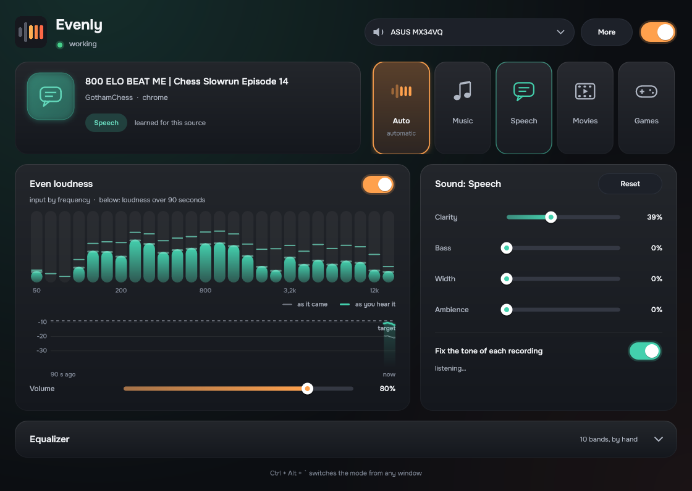

# Evenly

English · [Русский](README.ru.md)

**Sound on Windows that you never have to think about.**

Press play on a video, a lecture, a song or a game and the sound is already set up: nothing to tweak. Quiet clips are lifted, loud ads stop hitting your ears, speech stays clear, music stays full. Evenly works out what is playing, switches to the right mode and remembers your corrections.

It is a replacement for FxSound: the same effects, bit for bit, plus the things FxSound does not have. Free, no account, and nothing leaves your computer.



**Simple.** One power switch, five modes (Auto, Music, Speech, Movies, Games), four sliders. You can leave everything alone: Auto does the rest.

**Convenient.** Switch modes from any window with Ctrl + Alt + `. The window shows what is playing, which mode is on and why, a live spectrum, and the loudness of the last 90 seconds. It scales itself to your monitor and speaks 14 languages.

**Honest.** You can see what the program is doing to your sound. If the automatic choice is wrong, one click sets the right mode and it remembers that next time.

## What it does

- **Even loudness.** A quiet clip is pulled up, a loud ad is brought down at once, music does not "pump". Loudness is measured the way people hear it (ITU-R BS.1770, as used by broadcasters and streaming services), not by bass as FxSound does.
- **Picks the mode itself.** It looks at the app, the title and the channel (hundreds of keywords and apps in Russian and English: "lecture", "podcast", "official video", "trailer", Spotify, VLC, Discord…) and listens to the sound: speech has pauses between words, music has steady bass and cymbals. On recordings it never saw in training it tells speech from music 94–100 % of the time.
- **Learns.** Pick a mode for a channel or an artist once, and next time it switches on its own.
- **Gently fixes the tone of poor recordings.** Dull, boomy or thin recordings are pulled toward how good ones sound. It cannot work miracles, since it does not know how the recording sounded before it was damaged, so the correction is mild (details below). Good recordings are barely touched.
- **FxSound's effects:** Clarity, Bass, Width, Ambience and a 10-band equalizer. This is a port of FxSound's open-source code and gives the same sound bit for bit (checked on 7 presets and 3 recordings).
- **Quick menu.** Ctrl + Alt + ` (the key left of 1) in any program opens the mode picker: 1 Auto, 2 Music, 3 Speech, 4 Movies, 5 Games.
- **Keeps HDMI and DisplayPort audio awake.** Monitors and TVs switch their audio off after a few seconds of silence and swallow the start of the next sound. Evenly keeps the output awake.
- Runs inside the Windows audio engine: no virtual cables, no change of the default device, 1.5 ms latency. Windows volume keeps working as usual.
- 14 interface languages: English, Russian, Estonian, Ukrainian, German, French, Spanish, Italian, Portuguese, Polish, Dutch, Swedish, Finnish, Turkish. It follows your Windows language; change it in the More menu.

## Install

1. Download `Evenly-…-setup.exe` from [Releases](../../releases) and run it. Windows may warn that the program is unknown: the installer is not signed with a certificate, which costs money. Click "More info" → "Run anyway".
2. Open Evenly and press **Connect**. Windows asks for permission and the sound drops out for about a second: the program plugs itself into the audio of the chosen output (speakers, headphones, monitor).
3. If you have FxSound installed, Evenly offers to switch over. After that you can close FxSound, otherwise the sound is processed twice.

Uninstall it like any program, from Settings → Apps. The device settings go back exactly as they were.

## How it works

- **Processing.** A Windows system audio effect (APO), like Equalizer APO. It runs inside the Windows audio service and processes everything sent to the chosen output. If the program is closed, processing carries on with the last settings.
- **Chain:** input analysis → equalizer (yours plus the automatic tone correction) → FxSound effects → loudness leveling → peak limiter (ceiling −1 dB).
- **What is playing:** Windows "now playing" (title, artist or channel), the audio sessions of running programs and window titles.
- **The mode** is chosen by priority: your pick → your earlier pick for this source → what it learned → app and title → the sound. The sound changes the mode only when it is sure for several seconds in a row, so the mode does not flicker.
- Everything runs on your computer. The program sends nothing anywhere.

### How well the tone fix works

Good recordings (not from the training set) were damaged on purpose and run through Evenly the way the program does it. How much of the damage is removed:

| | Dull (−9 dB highs) | Boomy (+9 dB at 160 Hz) | Thin (−10 dB lows) | Harsh (+8 dB at 3.5 kHz) | Good recordings change by |
|---|---|---|---|---|---|
| Speech | 23 % | 26 % | 13 % | 1 % | ~0.8 dB |
| Music | 23 % | 9 % | 37 % | 8 % | ~0.3 dB |

A slow equalizer cannot fix a narrow harshness. The tone correction can be turned off with one switch.

## Limits

- Windows 10 and 11, 64-bit only.
- One output is processed at a time (the one chosen in the program).
- Programs that take the sound card in exclusive mode (some audio players using WASAPI Exclusive or ASIO) bypass all system effects, Evenly included.
- Movies and games are recognised from the app and the title; from the sound alone it tells only speech from music.
- This is a beta, tested on one computer so far (Windows 10, AMD audio over HDMI/DisplayPort). If something is off, please open an issue.

## Building from source

You need Visual Studio 2022 (or Build Tools) with C++ and the Windows SDK, CMake 3.22+, Ninja, and Inno Setup 6 for the installer. JUCE is downloaded automatically.

```
cmake -S . -B build -G Ninja -DCMAKE_BUILD_TYPE=Release
cmake --build build
iscc /DBuildDir=..\build installer\Rovno.iss
```

Targets: `Rovno` (the program), `RovnoApo` (the system effect), `rovno_ctl` (install the effect on an output, inspect, remove), `apo_host_test` (loads the effect the way Windows does and checks it), `rovno_render` and `rovno_tone` (process WAV files, for tuning). The scripts in `tools/` build the tone corridors and train the speech/music classifier. UI texts live in `tools/translations.py` (run it to regenerate `Source/app/Translations.inc` and to check that no language is missing a string).

The project was called Rovno ("evenly" in Russian) before it got its English name, so the source files and executables still use that name.

## License and credits

GNU AGPL 3.0 (see `LICENSE`).

- [FxSound](https://github.com/fxsound2/fxsound-app) (AGPL-3.0): the effect algorithms are ported from their open-source code.
- [JUCE](https://juce.com): the interface.
- [Equalizer APO](https://sourceforge.net/projects/equalizerapo/): its source showed how to plug an effect into Windows audio (no code was copied).
- The [Onest](https://github.com/googlefonts/onest) typeface (SIL OFL 1.1).
