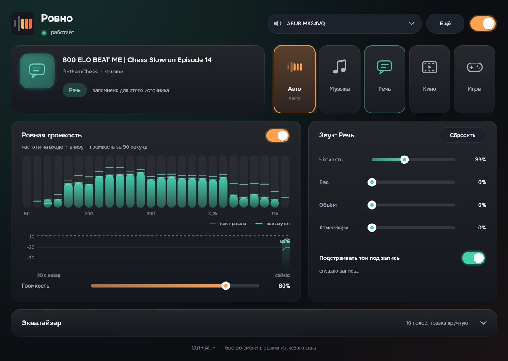

# Evenly («Ровно»)

[English](README.md) · Русский

**Звук в Windows, о котором не надо думать.**

Включили видео, лекцию, песню или игру, и звук уже подстроен: ничего не нужно крутить. Тихий ролик подтягивается, громкая реклама не бьёт по ушам, речь разборчива, музыка полная. «Ровно» сама понимает, что играет, включает подходящий режим и запоминает ваши поправки.

Это замена FxSound: те же эффекты, точь-в-точь, плюс то, чего в FxSound нет. Бесплатно, без аккаунта, ничего не отправляет в интернет.



**Просто.** Один выключатель, пять режимов (Авто, Музыка, Речь, Кино, Игры), четыре ползунка. Можно вообще ничего не трогать: режим «Авто» делает всё сам.

**Удобно.** Сменить режим можно из любого окна: Alt + `. Окно показывает, что сейчас играет, какой режим выбран и почему, а также живой спектр и график громкости за последние 90 секунд. Окно само подгоняется под монитор, на котором стоит (и заново, когда его перетащат на другой). Интерфейс на 14 языках, язык выбирается в меню «Ещё».

**Честно.** Видно, что программа делает со звуком. Если автоматика ошиблась, один клик возвращает нужный режим, и в следующий раз она это запомнит.

## Что умеет

- **Ровная громкость.** Тихий ролик подтягивается, громкая реклама сразу убирается, музыка не «дышит». Громкость считается так, как её слышит человек (по стандарту ITU-R BS.1770, как на телевидении и в стримингах), а не по басу, как в FxSound.
- **Сама выбирает режим.** Смотрит на программу, название и канал (больше сотни слов и программ по-русски и по-английски: «лекция», «подкаст», «official video», «трейлер», Spotify, VLC, Discord…) и слушает сам звук: в речи есть паузы между словами, у музыки ровный бас и тарелки. На записях, которых программа не видела при обучении, она отличает речь от музыки в 94–100 % случаев.
- **Учится.** Если вы выбрали режим для какого-то канала или исполнителя, в следующий раз он включится сам.
- **Подправляет тон плохих записей.** Глухие, бубнящие или тонкие записи подтягиваются к тому, как звучат хорошие. Чудес не бывает, программа не знает, как запись звучала до порчи, поэтому правка мягкая (подробнее ниже). Хорошие записи она почти не трогает.
- **Эффекты FxSound:** Чёткость, Бас, Объём, Атмосфера и 10-полосный эквалайзер. Это перенос открытого кода FxSound, и он даёт тот же звук бит в бит (проверено на 7 пресетах и 3 записях).
- **Быстрое меню.** Удерживайте Alt и нажмите ` (клавиша слева от единицы, на любой раскладке): над всеми окнами откроется панель, следующий режим подсвечен. Нажмите ` ещё раз, чтобы перейти дальше, или наведите мышь и щёлкните по режиму; отпустите Alt, и подсвеченный режим применится, а панель закроется. Короткое нажатие сразу переключает на следующий режим. Esc закрывает панель без изменений. Фокус клавиатуры она не забирает.
- **Не даёт HDMI-звуку засыпать.** Мониторы и телевизоры по HDMI выключают звук через несколько секунд тишины и съедают начало следующего звука. «Ровно» держит выход проснувшимся.
- **Подстраивается под вас.** Размер окна выбирается по монитору, на котором оно стоит: от небольших экранов ноутбуков до ультрашироких, с учётом масштаба Windows. Наушники и гарнитуры распознаются и получают более мягкую громкость; колонки и мониторы получают полную громкость в стиле FxSound. У каждого выхода своя запомненная громкость. Какой режим подходит какому источнику и поправки тона выучиваются по вашим же выборам.
- Работает внутри звука Windows: без виртуальных кабелей, без смены устройства по умолчанию, с задержкой 1,5 мс. Громкость Windows продолжает работать как обычно.

## Установка

1. Скачайте `Evenly-…-setup.exe` из [Releases](../../releases) и запустите. Windows может предупредить, что программа неизвестна: установщик не подписан сертификатом, это платная услуга. Нажмите «Подробнее» → «Выполнить в любом случае».
2. Откройте «Ровно» и нажмите **«Подключить»**. Windows спросит разрешение, звук пропадёт примерно на секунду: программа встраивается в звук выбранного выхода (колонок, наушников, монитора).
3. Если у вас стоит FxSound, программа предложит переключиться. После этого FxSound можно закрыть, иначе звук будет обработан дважды.

Удаляется «Ровно» как обычная программа через «Параметры» → «Приложения». Настройки устройства при этом возвращаются в точности как были.

## Как это работает

- **Обработка.** Системный звуковой эффект Windows (APO), как в Equalizer APO. Он работает внутри службы звука и обрабатывает всё, что идёт на выбранный выход. Если программа закрыта, обработка продолжается с последними настройками.
- **Цепочка:** анализ входа → эквалайзер (ваш и автоматическая правка тона) → эффекты FxSound → выравнивание громкости → ограничитель пиков (потолок −1 дБ).
- **Что играет:** «Сейчас играет» Windows (название, исполнитель или канал), звуковые сессии программ и заголовки окон.
- **Режим** выбирается по старшинству: ваш выбор → ваш прежний выбор для этого источника → выученное → программа и название → звук. Звук меняет режим, только если уверен несколько секунд подряд, чтобы режим не дёргался.
- Всё работает на вашем компьютере. Программа ничего никуда не отправляет.

### Насколько хорошо правится тон

Проверка: хорошие записи (не из обучающих) нарочно портились, а потом прогонялись через «Ровно» так же, как это происходит в программе. Сколько порчи убрано:

| | Глухо (−9 дБ верхов) | Бубнит (+9 дБ на 160 Гц) | Тонко (−10 дБ низа) | Резко (+8 дБ на 3,5 кГц) | Хорошие записи меняются на |
|---|---|---|---|---|---|
| Речь | 23 % | 26 % | 13 % | 1 % | ~0,8 дБ |
| Музыка | 23 % | 9 % | 37 % | 8 % | ~0,3 дБ |

Узкую резкость медленный эквалайзер не исправляет. Правку тона можно выключить одним переключателем.

## Ограничения

- Только Windows 10 и 11, 64 бита.
- Обрабатывается один выход за раз (тот, что выбран в программе).
- Вручную настроены звуковые параметры только для ASUS MX34VQ; на любом другом выходе общий профиль (нейтральный эквалайзер, громкость в стиле FxSound для речи и музыки, мягче для наушников). Если нужно иначе, есть ползунки и эквалайзер.
- Программы, которые захватывают звуковую карту в монопольном режиме (некоторые аудиоплееры с WASAPI Exclusive и ASIO), обходят любые системные эффекты, в том числе «Ровно».
- Кино и игры программа узнаёт по программе и названию; по звуку она различает только речь и музыку.
- Это бета. Проверено на одном компьютере (Windows 10, звук AMD по HDMI). Если что-то не так, напишите в Issues.

## Сборка из исходников

Нужны Visual Studio 2022 (или Build Tools) с C++ и Windows SDK, CMake 3.22+, Ninja и Inno Setup 6 для установщика. JUCE скачается сам.

```
cmake -S . -B build -G Ninja -DCMAKE_BUILD_TYPE=Release
cmake --build build
iscc /DBuildDir=..\build installer\Rovno.iss
```

Цели: `Rovno` (программа), `RovnoApo` (системный эффект), `rovno_ctl` (установка эффекта на выход, проверка, удаление), `apo_host_test` (загружает эффект так же, как Windows, и проверяет его), `rovno_render` и `rovno_tone` (обработка WAV-файлов, для настройки). Скрипты в `tools/` строят коридоры тона и обучают распознавание речи и музыки.

## Лицензия и благодарности

GNU AGPL 3.0 (см. `LICENSE`).

- [FxSound](https://github.com/fxsound2/fxsound-app) (AGPL-3.0): алгоритмы эффектов перенесены из их открытого кода.
- [JUCE](https://juce.com): интерфейс.
- [Equalizer APO](https://sourceforge.net/projects/equalizerapo/): по его исходникам изучено, как встраивать эффект в звук Windows (код не копировался).
- Шрифт [Onest](https://github.com/googlefonts/onest) (SIL OFL 1.1).
